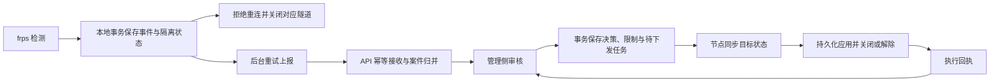

# 节点检测、隔离上报与管理决策实施方案

日期：2026-10-16。本文为设计方案，尚未实施业务代码或数据库变更。

## 1. 目标与默认范围

形成完整流程：节点检测 → 本地临时隔离 → 持久化上报 → 管理侧审核 → 封禁或解除 → 节点执行确认 → 申诉复核。

第一版接入已有 VPN/代理协议检测，保留目前跨境判断；通用事件模型预留站点违规类型。色情/网站扫描、截图采集属于独立检测器，现有 porn/site 接收类型不代表扫描能力已经实现，不混入第一版交付。

默认处置建议：

| 情况 | 节点行为 | 管理侧行为 |
| --- | --- | --- |
| 启发式可疑命中 | 记录并上报，不自动隔离 | 待人工审核 |
| 明确协议命中且符合跨境规则 | 临时隔离对应隧道，默认 30 分钟，可配置 | 审核后解除、封禁隧道或封禁账号 |
| 已有正式封禁 | 拒绝新建对应隧道并关闭现有连接 | 显示封禁范围、期限和执行进度 |
| 临时隔离到期但尚未审核 | 解除该临时限制，案件仍待审；再次命中可产生新的隔离周期 | 显示超期待审，允许管理员主动延长 |

账号永久封禁默认由管理员决定。后续如增加自动决策，应复用相同决策服务、审计和执行流程，不能另建直接修改用户组的旁路。

## 2. 必须保证的行为

- 网络允许重复发送；业务入库、计数、审核和节点执行保持幂等。不能以“HTTP 只发一次”保证正确性。
- API 成功响应意味着事件已持久化提交；节点收到对应确认后才清理待发送数据。
- 节点重启、API 重启、响应丢失后，可以继续重试，不重复建事件、案件或封禁。
- 管理员重复点击、跨页面提交、多人并发审核，只能产生一次有效决策。
- 延迟到达的旧封禁不能覆盖新解封，旧解封也不能清除后续新封禁。
- 审核完成与节点执行完成分别显示；离线节点不能被标记为执行成功。
- 上报接受成功与图片证据上传成功分别显示，无图片事件不依赖 S3。

可靠性边界：保证依赖节点本地存储与服务端数据库正常持久化；磁盘损坏、队列耗尽等情况必须显式告警，不能承诺绝对不丢失，也不能静默丢弃未确认事件。

## 3. 数据流与状态

三套状态独立维护：

| 对象 | 状态示例 | 意义 |
| --- | --- | --- |
| 检测事件 | queued / accepted / needs_attention | 一次不可变事实是否送达 |
| 审核案件 | pending / dismissed / enforced / closed | 管理员如何判断一组事实 |
| 节点执行 | pending / applied / failed / superseded | 指定版本的目标状态是否实际应用 |

管理员决定封禁后，案件可以是 enforced，而某个离线节点仍是 pending；面板必须展示这种差异。

## 4. 节点侧实现

### 4.1 统一检测出口

TCP、UDP 共用检测事件接口，记录检测器、规则版本、协议、置信度、跨境判定依据、发生时间、隧道和连接身份。

修复 TCP `sync.Once`：可疑命中后仍允许升级为明确命中；按“可疑已通知、明确已通知”分别控制回调。UDP 使用相同升级规则。

由 API 在隧道校验结果中返回稳定的 tunnel_id、user_id 和映射版本；规则执行与事件归属使用 ID，名称只保留快照。节点身份由服务端根据鉴权确定，不能相信上报体自填的 node_id。旧节点仅有 token/名称时由 API 校验归属并解析，不能接受任意用户与隧道组合。

### 4.2 本地隔离和持久队列

- 使用单 frps 进程独占的本地嵌入式事务存储，事件、待发状态和临时隔离在同一事务保存。
- 持久化后立即阻止该隧道的新注册与新连接，并关闭对应隧道及其已有转发连接；隔离不依赖 API 在线。
- 启动时先恢复限制，再对外接收隧道；同一隧道的多个并发连接共享隔离状态。
- 为每个逻辑事件生成 event_id，先持久化再发送；重试、重启不生成新 ID。
- HTTP 工作线程与转发线程分开；仅本地持久写入参与触发路径，网络请求不阻塞转发。
- 重试采用指数退避和随机抖动；429 遵守 Retry-After，网络错误/5xx 重试；401/403 暂停并报警；格式错误转人工处理队列，不能当作成功删除。
- 设置请求超时、队列字节与数量限制、待发最久时长告警。容量告急时优先保留明确命中，重复命中合并；无法持久化时保留内存临时隔离并报告降级，不能伪造已可靠保存。
- 临时限制使用固定 expires_at；重放相同事件不能把隔离期限不断向后延长。

### 4.3 同一次命中的重复回调

同一连接同一规则同一严重程度只产生一次逻辑事件。多个连接的独立命中可以产生独立事件，但归并到同一案件。

高频重复命中按固定聚合周期生成累计摘要，使用 observation_id + sequence；同一摘要的重试只计一次，累计计数取新版本差量，不对重复请求无条件加一。严重程度升级立即生成独立升级事件。

## 5. 上报接收、案件归并与证据

### 5.1 传输幂等与业务归并

新增版本化 JSON 事件接口，保留现有 multipart 接口用于兼容，不把普通检测事件强制绑定图片上传。

事件最小字段：event_id、schema_version、detector、rule_id、rule_version、severity、tunnel_id、occurred_at、local_action、local_restriction_id、local_expires_at、facts，以及可选 evidence_manifest。

接口规则：

1. 数据库建立 UNIQUE(node_id, event_id)，使用实际唯一约束处理多实例并发，不能只做“先查询再插入”。
2. 对规范化业务字段及证据清单计算 payload_hash，排除请求时间、重试次数等传输字段。同 ID、同内容返回原 event_id/case_id 与 accepted 标记；同 ID、不同内容返回 409，不能覆盖原事实。
3. 事件入库、案件归并、计数变化和必要任务，在同一数据库事务提交后返回确认。
4. 同节点/隧道/规则族在尚未结束的同一处置周期内，归入同一活动案件；用受唯一约束保护的活动案件键串行创建，避免并发创建两个案件。
5. 审核后的新事实保留到达时间和实际发生时间。旧周期延迟事件不能推翻决定；解除后真正重新命中开启新周期。跨节点案件可以关联用户风险，但不能误删不同节点的事实。
6. 数据清理后仍保留幂等摘要或墓碑，保留期覆盖节点最长重试周期；过期重放明确拒绝，不能再次建案。

### 5.2 图片证据独立上传

- 先接受事件，再按 event_id/evidence_id 上传证据，案件显示 pending/ready/failed 证据状态。
- 节点对图片按现有 RSA-OAEP-SHA256 + AES-256-GCM 协议加密一次，密文持久保存；重试复用同一密文，不能重新随机加密造成摘要变化。
- 对象键按稳定事件和证据 ID 生成，数据库 UNIQUE(event_id, evidence_id)，同 ID 的摘要/大小必须一致。
- 上传、最终确认均可重试；同一对象重复写入必须得到相同内容。并发上传不得使已确认元数据指向不同字节。
- 数据库事务不跨 S3 网络调用长时间持锁；使用上传状态和确认步骤衔接，定时清理未引用的暂存对象。
- 公钥增加 key_id，历史证据记录对应版本，管理员可以使用相应历史私钥解密。API 不保存私钥。

## 6. 管理侧决策与并发控制

管理员可选择：判为误报并解除隔离、确认违规但仅警告、封禁隧道、限期/永久封禁账号；申诉通过后解除指定限制。

“通过”“驳回”改为明确的动作名称，避免与“确认违规”混淆。永久封禁或账号级封禁要求填写理由，保存操作人、时间、范围、期限、依据和前后状态。

审核请求包含 request_id、expected_version、action、scope、reason、expires_at：

- UNIQUE(管理员身份, request_id)，重复请求返回已提交的原结果；同请求 ID 改变参数返回 409。
- 通过 expected_version 和允许的当前状态做条件更新。不同管理员并发决策，只允许一个成功；另一个返回 409 并要求刷新，不采用后写覆盖。
- 决策记录、案件版本、限制变更、审计日志和执行 outbox 同事务提交。关键审计失败应使决策回滚，不能无审计地成功。
- outbox 工作线程可重复消费，使用租约和任务 ID 处理 API 多实例并发；服务崩溃后继续派发。
- 已完成审核需要修改时，提交独立的撤销/复核决策，不能直接重写旧审核结果。

案件归并、审核、申诉同时到达时，按案件/用户对应行锁统一顺序执行，防止状态交叉覆盖和死锁重试产生重复效果。

## 7. 封禁作为独立限制

正式封禁使用 restriction 表独立保存，范围为 user 或 tunnel，包含来源 decision_id、有效期、解除信息。账号可同时有多条限制。

- 有效权限 = 原有账号权益与所有有效限制共同计算；封禁不再修改会员组、带宽或到期时间。
- 解除某一条限制，只清除该条限制；其他案件、人工封禁、其他隧道限制继续生效。
- 解封时不把历史权益快照写回当前用户，避免覆盖封禁期间购买、到期或管理员调整。
- API 的 checktoken、checkproxy、getcfg，以及隧道创建/修改/启动等入口统一查询限制，修复当前“封禁组映射成 VIP”的问题。
- 保留用户登录、查看封禁理由和提交申诉的通道。
- 申诉提交本身也使用 request_id；同一封禁只允许一条待审申诉，通过数据库约束与封禁行锁实现，不只依赖前端按钮禁用。
- 申诉审核和解除限制在同一事务完成；如果还有其他有效限制，返回“本条已解除，账号仍受其他限制”，不能显示全部解封。

旧“封禁”组和快照记录需要迁移：能可靠还原的转换成限制；缺少可靠原权益的保留兼容拦截并进入人工处理清单，不能猜测恢复会员等级。

## 8. 节点执行与乱序保护

API 维护每个作用域的完整目标状态和单调递增 revision，不仅下发一次性 close 命令。

- 节点主动同步是可靠通道；在线节点可增加即时推送作为加速，但失败后仍由同步补齐。
- 节点验证作用域、revision 和状态摘要；同版本同内容直接返回原执行结果；同版本不同内容拒绝；旧版本忽略并返回当前已应用版本。
- 目标状态先持久化，再更新拦截规则并关闭相关连接；只有全部应用后回执 applied。崩溃重启时重放未完成应用。
- 节点同步包含初次全量快照、分页增量、断点游标和删除墓碑；游标失效后重新全量，不允许缺页后提前提交游标。
- API 定期对比 desired_revision 与 applied_revision，发现不一致继续派发；不能仅依赖工作线程发过一次请求。
- 账号封禁覆盖所有节点的注册校验，并向所有可能持有该用户会话的节点收敛下线状态，不能仅依赖可能过时的 tunnel.state 在线标记。
- 账号 token 变化不改变 user_id 级限制；节点会话绑定稳定用户 ID，避免 token 轮换绕过封禁。
- 解除需要区分节点临时隔离来源和正式封禁来源。管理侧误报解除明确关联的隔离周期，延迟旧事件不能重新启用该周期；新的独立命中仍可启动新周期。
- 节点与 API 失联时继续执行已持久化的有效限制，允许按明确 expires_at 到期；默认拒绝无法完成中央校验的新注册。离线节点上的已有正常连接无法保证立即获知新封禁，面板必须显示未同步。

临时隔离、隧道正式封禁、账号正式封禁叠加计算；针对一个范围的解除不能覆盖另一个范围的限制。

## 9. 数据结构与接口交付

最低数据职责：

| 结构 | 关键约束或用途 |
| --- | --- |
| detection_event | UNIQUE(node_id, event_id)，payload_hash，不可变事实 |
| violation_case / active_case_key | 活动案件归并、处置周期、版本 |
| violation_decision | 审核请求幂等、不可变决策和复核关系 |
| restriction | 用户/隧道限制，多来源叠加 |
| enforcement_outbox / node_application | 待派发目标版本、租约、逐节点应用确认 |
| violation_evidence | 事件/证据唯一键、密文摘要、key_id、上传状态 |
| violation_appeal | 请求幂等、同封禁待审唯一性 |

已有 violation_record、user_ban_record 可分阶段演进或保留为兼容展示，不要求一次删除重建；新增 SQL 必须随代码版本提供迁移及回滚说明。

新增接口职责：事件提交与状态查询、证据上传与确认、节点限制同步与执行回执、管理员决策与复核、案件执行进度、申诉提交与审核。使用独立协议版本，不静默改变现有客户端的字段语义。

节点鉴权复用每节点 apiToken，校验只能提交归属于本节点的隧道信息和执行回执；公网上传使用 TLS，避免把用户 token 放入新接口 URL。日志和后台不回显凭据。管理侧复用管理员鉴权。

## 10. 面板改造

- 列表增加首次/最近命中、独立事件数、规则、置信度、临时隔离剩余时间、案件状态。
- 详情展示事件时间线、判定依据、证据上传状态和历史决策。
- 决策表单支持范围、期限、理由，提交期间锁按钮；网络超时后的重试沿用同一 request_id。
- 提交前后保持 expected_version；冲突提示“其他管理员已处理”，刷新真实结果。
- 展示每节点待执行/成功/失败/离线及最后确认时间，允许重新触发同步，不能把重试变成新封禁。
- 用户封禁页显示每条限制与申诉入口；管理员清楚看到同一用户仍有哪些有效限制。
- 对暂时放行和长期误报例外分别建模；如增加例外，应限定规则、隧道、范围和期限，并保留审计，不能建立永久全账号免检旁路。

## 11. 实施顺序与验收

| 阶段 | 仓库及内容 | 可验收结果 |
| --- | --- | --- |
| P0 | API 限制模型、迁移、统一入口检查；核对 API 客户端下线 GET 与 frps POST 的现有不一致 | 手工封禁后不能重新注册；下线接口可用；账号权益不被覆盖 |
| P1 | API 事件幂等、案件归并、无图片上报；frp 稳定身份、持久队列、临时隔离、检测升级修复 | 断网和节点重启后仍会上报；重复发送只产生一个事件 |
| P2 | 管理决策事务、并发控制、outbox、节点目标状态同步与回执；面板决策和执行进度 | 多人审核只生效一次；封禁与解除可跨节点收敛且不被旧指令覆盖 |
| P3 | 证据独立上传、密钥版本、申诉幂等、多限制解封、完整面板流程 | 图片失败不影响事件送达；申诉通过只解除对应限制 |
| P4 | 故障演练、观测指标、兼容迁移、按节点灰度 | 全链路与失败路径通过后再全量开启 |

自动化验收至少覆盖：

1. 同事件并发提交 100 次，只出现一个事件；同 ID 不同内容返回冲突。
2. API 提交后响应丢失，节点重试返回原结果，案件计数不增加。
3. 隔离保存后节点退出，重启先恢复隔离并补报；API 事务回滚不返回接受成功。
4. 两个 API 实例同时归并命中，只创建一个活动案件；不同事件计数准确。
5. 两名管理员同时放行和封禁，仅一个版本更新成功；相同审核请求重放不生成第二次决策。
6. 决策提交后工作线程退出，恢复后仍执行；节点应用后回执丢失，重发不重复产生副作用。
7. 封禁/解封乱序、同 revision 内容冲突、跨范围叠加、节点离线后恢复都按最新有效状态执行。
8. 多个封禁同时有效时，解除其中一条不能解封整个账号；会员自然到期与申诉并发不恢复过期权益。
9. 同一封禁并发提交申诉只能有一条待审；重复审核不重复解除。
10. S3 未配置、上传失败、重复上传、部分证据成功、历史密钥解密分别有明确结果，未完成上传不会伪装为完整证据。
11. 可疑检测后升级明确命中正常隔离；重试旧事件不延长隔离，也不撤销已作出的误报决定。
12. 队列满、磁盘写失败、401、429、API 长时间不可用、同步游标失效均有可观测状态和恢复路径。

指标至少包括：本地待发数量/字节与最旧事件年龄、重试与异常队列、幂等重放/冲突次数、待审时长、节点同步延迟和待应用限制数。

灰度依次开启事件观察、临时隔离、管理侧正式处置。回滚检测版本不清空已生效限制；未支持新协议的节点明确标记能力不足，不能声称已执行完整封禁。新决策能力与临时隔离按节点能力逐步开放。
